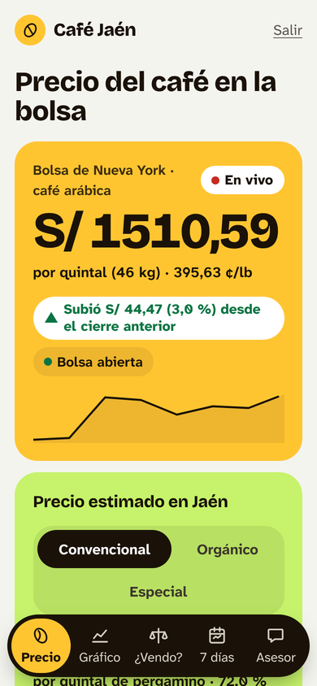
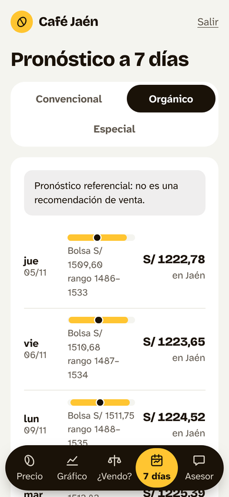
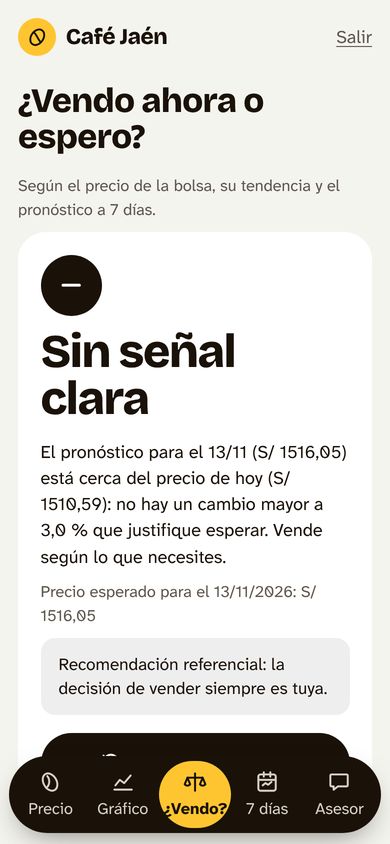
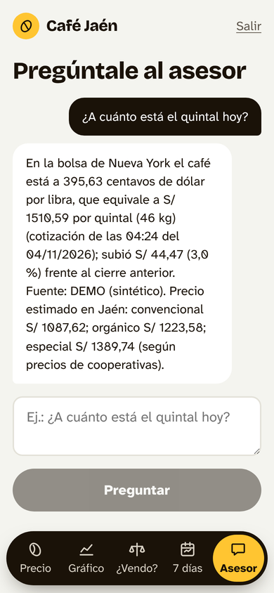
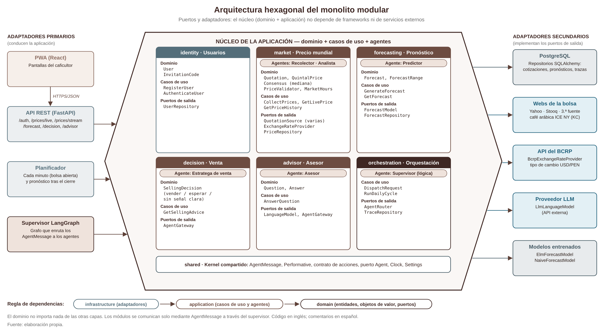
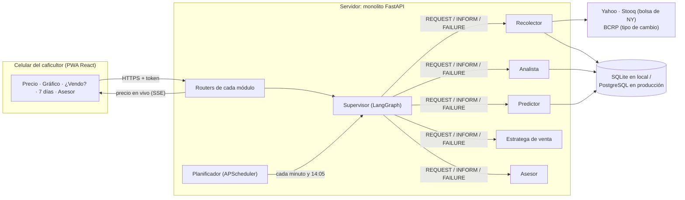

# ☕ Café Jaén

Aplicación web con agentes inteligentes para mejorar la percepción del valor de mercado en los
caficultores de Jaén. Es el producto de nuestra tesis en la Universidad Privada Antenor Orrego
(UPAO, 2026).

Desarrollamos una app en la que el caficultor ve **en vivo, como en una pantalla de bolsa, a
cuánto se vende el café en el mundo** (bolsa de Nueva York, consultada en varias webs a la vez),
lo que se paga **en Jaén** por su tipo de café, el gráfico del precio, un **pronóstico a 7 días**,
la recomendación **«¿Vendo ahora o espero?»** y un **asesor** que responde en lenguaje sencillo.
Detrás, seis agentes coordinados por un supervisor mantienen los datos al día sin intervención
humana.

> **Versión:** v1.3 (plan XP v4.0) · **Metodología:** Extreme Programming (XP) ·
> **Arquitectura:** monolito modular hexagonal + sistema multiagente con supervisor

| Integrante | GitHub | Rol en XP | Lidera |
|---|---|---|---|
| Chavez Canaquiri, Jhon Xavier | [jhon1212-beep](https://github.com/jhon1212-beep) | Programador · encargado de seguimiento | Precio mundial en vivo, pronóstico, «¿Vendo?», animaciones |
| Reyes Guerrero, Luis Benjamin | [BenjaminGRUPO6](https://github.com/BenjaminGRUPO6) | Programador · entrenador (coach) | Usuarios, supervisor, asesor, interfaz, plataforma |

**Asesor:** Cieza Mostacero, Segundo Edwin.

<p>
  
  
  
  
</p>

## Demo en línea

| | |
|---|---|
| **App publicada (Render)** | [https://cafe-jaen-oa58.onrender.com](https://cafe-jaen-oa58.onrender.com) · códigos de invitación `DEMO-0001` a `DEMO-0010` |
| **Edición en el navegador (Codespaces)** | **Code → Codespaces → Create codespace on main** y luego `python dev.py start` |

Publicamos la app en el plan gratuito de Render con un precio de demostración, una base
PostgreSQL gratuita (Neon) para que los registros sean permanentes y una cuenta del equipo que se
crea sola al arrancar. Si estuvo un rato
sin visitas, tarda alrededor de un minuto en despertar. Cada `git push` a `main` la vuelve a
desplegar sola. Cómo lo configuramos: [docs/despliegue.md](docs/despliegue.md).

---

## Contenido

1. [Qué hace la aplicación](#qué-hace-la-aplicación)
2. [Cómo se relaciona con los indicadores de la tesis](#cómo-se-relaciona-con-los-indicadores-de-la-tesis)
3. [Arquitectura](#arquitectura)
4. [Estructura del repositorio](#estructura-del-repositorio)
5. [Tecnologías](#tecnologías)
6. [Cómo lo ejecutamos en local](#cómo-lo-ejecutamos-en-local)
7. [Cómo trabajamos con Git y GitHub](#cómo-trabajamos-con-git-y-github)
8. [Calidad, pruebas y criterios de aceptación](#calidad-pruebas-y-criterios-de-aceptación)
9. [Plan XP y división del trabajo](#plan-xp-y-división-del-trabajo)
10. [Convenciones de código](#convenciones-de-código)
11. [Trabajo futuro](#trabajo-futuro)
12. [Documentación](#documentación)

---

## Qué hace la aplicación

Organizamos el producto en historias de usuario (XP). Estas son las que implementamos:

| Historia | Qué ve o hace el caficultor | Agente |
|---|---|---|
| HU01 | Registro con **código de invitación** (solo grupo experimental) y consentimiento informado | — |
| HU02 | Precio de la bolsa consultado **cada minuto en varias webs**, consolidado por mediana | Recolector |
| HU03 | **Precio en vivo tipo bolsa**: ¢USD/lb y S/ por quintal, sube/baja, hora y fuentes; se actualiza solo | Analista |
| HU04 | Gráfico de **hoy** (minuto a minuto), 30 y 90 días, con máximo, mínimo y variación | Analista |
| HU05 | **¿Vendo ahora o espero?** con su motivo en números y su porcentaje de acierto | Estratega de venta |
| HU06 | Pronóstico a 7 días con su rango, **en la bolsa y estimado en Jaén** por tipo de café | Predictor |
| HU07 | Coordinación de agentes con mensajes estándar y trazas | Supervisor |
| HU08 | Preguntas en lenguaje natural, sin precios inventados | Asesor |
| HU09 | Letra grande, se instala en el celular y muestra el último precio sin señal | — |
| HU10–11 | Producción, manual de usuario e inducción | — |
| HU12 | **Precio estimado en Jaén**: la bolsa × el porcentaje que pagan las cooperativas (los precios los anotamos nosotros en la pantalla «Equipo») | Analista |
| Equipo | Área solo para administrador: **Precios** de cooperativas y **Participantes** del GE (quién se registró, con qué código y cuándo entró), en vivo | — |
| HU15 | Interfaz dinámica: colores vivos, precio que rueda al cambiar, animaciones que responden al toque | — |
| HU16 | Ejecución local en un paso (Windows, macOS, Linux), despliegue en línea y dependencias que se actualizan solas | — |

> **Sobre el «tiempo real»:** los datos de la bolsa ICE al segundo requieren licencia, y las webs
> gratuitas publican con algunos minutos de retraso. Por eso decidimos mostrar siempre la **hora
> de la cotización** ([decisión 0006](docs/decisiones/0006-varias-fuentes-y-sse.md)).

## Cómo se relaciona con los indicadores de la tesis

Medimos los indicadores **fuera de la app**, con los mismos instrumentos para el grupo
experimental (GE) y el grupo control (GC) ([decisión 0003](docs/decisiones/0003-medicion-fuera-de-la-app.md)).
La app es la intervención que recibe solo el GE.

| Indicador | Cómo lo medimos | Qué hace la app para mejorarlo |
|---|---|---|
| **TAI** = tf − ti (minutos) | Ficha de observación con cronómetro | El precio aparece al abrir la app y se actualiza solo cada minuto |
| **NCP**ᵢ = aciertos / preguntas × 100 | Cuestionario de conocimiento del precio | Precio de la bolsa, variación y precio estimado en Jaén por tipo de café |
| **TPP** = [1 − \|Pp − Pr\| / Pr] × 100 | Ficha: precio predicho vs. precio real (S/ por quintal de pergamino) | Pronóstico a 7 días **en Jaén**, en la misma unidad que se predice ([decisión 0009](docs/decisiones/0009-pronostico-en-jaen.md)) |
| Usabilidad (SUS) | Cuestionario SUS, solo al GE | — |

El acceso es solo con código de invitación (uno por participante del GE); así nos aseguramos de
que el GC no pueda entrar a la app.

## Arquitectura

### Monolito modular hexagonal

Elegimos una sola aplicación y una sola base de datos, dividida en **módulos independientes**.
Cada módulo tiene tres capas y las dependencias apuntan siempre hacia adentro:

```
infrastructure  ──▶  application  ──▶  domain
(FastAPI, SQLAlchemy,   (casos de uso      (reglas del negocio,
 webs de la bolsa,       y agentes)          sin frameworks; define
 LangGraph, LLM)                             los puertos)
```



Para no romper esta regla sin darnos cuenta, definimos tres contratos de
[`import-linter`](backend/.importlinter) que se revisan en cada commit y en la CI:

| Contrato | Qué obliga |
|---|---|
| Capas hexagonales | `infrastructure → application → domain`: el dominio no conoce FastAPI, la base de datos ni las webs |
| Módulos independientes | `identity`, `market`, `forecasting`, `decision`, `advisor` y `orchestration` no se importan entre sí: hablan con mensajes `AgentMessage` |
| Kernel compartido | `shared` no depende de ningún módulo |

Gracias a esto, cambiar Yahoo por otra web o SQLite por PostgreSQL es cambiar un adaptador, sin
tocar las reglas del negocio.

### Cómo funciona



| Agente | Módulo | Qué hace |
|---|---|---|
| Supervisor | `orchestration` | Recibe cada pedido y lo envía al agente correcto; registra la traza |
| Recolector | `market` | Consulta varias webs, publica la mediana y descarta la que discrepa |
| Analista | `market` | Precio en S/ por quintal, variación, histórico y estimado en Jaén |
| Predictor | `forecasting` | Pronóstico a 7 días con ELM y modelo base; elige el de menor error (MAPE) |
| Estratega de venta | `decision` | «Vender ahora», «Esperar» o «Sin señal clara», con umbral de 3 % |
| Asesor | `advisor` | Responde preguntas usando los datos de los otros agentes, sin inventar números |

**Los tres flujos principales:**

1. **Precio en vivo (cada minuto, lunes a viernes):** planificador → Recolector → varias webs →
   mediana validada → `live_quotes` → el celular la recibe por SSE y los dígitos del precio ruedan.
2. **Ciclo diario (14:05, hora de Lima):** cierre del día → histórico → nuevo pronóstico →
   recomendación lista.
3. **Consulta del caficultor:** pantalla → API → Supervisor → Estratega o Asesor → respuesta
   `INFORM` (o `FAILURE` controlado, nunca un error 500).

El detalle completo, los diagramas y las propiedades de agente inteligente están en
[docs/arquitectura.md](docs/arquitectura.md).

## Estructura del repositorio

```
cafe-jaen-sistema/
├── dev.py                         ← tareas en un comando (Windows, macOS y Linux)
├── backend/                       ← MONOLITO (FastAPI + Python)
│   ├── src/
│   │   ├── main.py                ← raíz de composición: crea adaptadores y los inyecta
│   │   ├── shared/                ← kernel: AgentMessage, contrato de agentes, configuración
│   │   ├── identity/              ← registro, ingreso, roles
│   │   ├── market/                ← precio en vivo y estimado en Jaén (Recolector, Analista)
│   │   ├── forecasting/           ← pronóstico (Predictor)
│   │   ├── decision/              ← «¿Vendo ahora o espero?» (Estratega)
│   │   ├── advisor/               ← asesor (Asesor)
│   │   └── orchestration/         ← supervisor (LangGraph) y planificador
│   ├── migrations/                ← Alembic 0001–0003
│   ├── scripts/                   ← demo, admin, ciclo diario, arranque en producción, carga
│   ├── tests/                     ← unit/ · integration/ · acceptance/ · load/
│   └── .importlinter              ← contratos de arquitectura
├── frontend/                      ← PWA (React + Vite + Framer Motion)
│   └── src/
│       ├── features/              ← una carpeta por pantalla
│       │   ├── live/              ← precio en vivo, estimado en Jaén, gráfico
│       │   ├── forecast/          ← pronóstico (bolsa y Jaén)
│       │   ├── decision/  advisor/  admin/  auth/
│       └── shared/
│           ├── api/               ← cliente HTTP y flujo en vivo (SSE)
│           ├── motion/            ← animaciones: Ticker, Sparkline, Reveal, Segmented…
│           ├── components/  hooks/  auth/
│           ├── texts/es.ts        ← todos los textos que ve el caficultor
│           └── styles.css         ← paleta «Cosecha» y diseño
├── docs/                          ← arquitectura, decisiones (ADR), XP, paleta, manual
├── .github/                       ← CI y Dependabot
├── .devcontainer/                 ← entorno de GitHub Codespaces
├── Dockerfile · render.yaml       ← despliegue en Render (app + API en un solo servicio)
├── docker-compose.yml             ← opcional: PostgreSQL + API como en producción
└── Makefile                       ← atajos opcionales (llaman a dev.py)
```

Cada módulo del backend repite las mismas capas. Por ejemplo, `market`:

```
market/
├── domain/          live_price.py · consensus.py · price_validator.py · market_hours.py
│   │                local_price.py · quintal_price.py
│   └── ports/       QuotationSource · PriceRepository   ← interfaces
├── application/     collect_prices.py · get_live_price.py · get_price_history.py · record_local_price.py
│   └── agents/      collector_agent.py (Recolector) · analyst_agent.py (Analista)
└── infrastructure/
    ├── sources/     yahoo · stooq · demo · bcrp           ← adaptadores de las webs
    ├── persistence/ repositorios SQLAlchemy
    └── api/         market_router.py (/prices/live, /history, /stream, /admin/local-prices)
```

## Tecnologías

| Capa | Herramienta | Por qué la elegimos |
|---|---|---|
| Backend | Python 3.12, FastAPI, Pydantic | API tipada que se documenta sola en `/docs` |
| Agentes | LangGraph | Grafo del supervisor: un nodo por agente |
| Datos | SQLAlchemy + Alembic; **SQLite** en local, **PostgreSQL** en producción | Para desarrollar no hace falta instalar una base de datos |
| Pronóstico | NumPy (ELM y modelo base) | Liviano y explicable |
| Planificador | APScheduler | Cada minuto y ciclo diario |
| Frontend | React 19, Vite 6, TypeScript, Recharts | PWA instalable y rápida en 3G; Vite 6 corre desde Node 20 |
| Diseño | Framer Motion, Bricolage Grotesque, Atkinson Hyperlegible Next | Interfaz viva y legible al sol ([paleta](docs/paleta.md)) |
| Calidad | pytest, Vitest, ruff, mypy, import-linter, ESLint, Prettier | Las mismas revisiones en local y en la CI |
| Despliegue | Docker, Render, GitHub Codespaces | App pública gratuita y edición en el navegador |
| Mantenimiento | `dev.py`, GitHub Actions, Dependabot | Un comando para todo y actualizaciones semanales validadas |

**Qué simplificamos en la v1.1** ([decisión 0008](docs/decisiones/0008-herramientas-simples.md)):
- **Sin Docker en local:** usamos SQLite por defecto.
- **Sin `make` obligatorio:** `dev.py` funciona también en Windows.
- **Sin secretos escritos a mano:** el `setup` los genera.
- **Dependencias al día:** Dependabot abre los PR de actualización.

## Cómo lo ejecutamos en local

### Requisitos

| Programa | Versión | Descarga |
|---|---|---|
| Python | 3.11 o más nuevo (usamos 3.12 y 3.13) | https://www.python.org/downloads/ (en Windows, con «Add python.exe to PATH») |
| Node.js | 20 o 22 (lo probamos con 22.11 y 22.22) | https://nodejs.org |
| Git | cualquiera reciente | https://git-scm.com |

### Pasos

```bash
git clone https://github.com/jhon1212-beep/cafe-jaen-sistema.git
cd cafe-jaen-sistema
python dev.py setup     # instala backend y frontend, y crea backend/.env con un secreto aleatorio
python dev.py demo      # datos de demostración, primer pronóstico y códigos DEMO-0001 a DEMO-0010
python dev.py start     # levanta la API (puerto 8000) y la app (puerto 5173)
```

Con eso, la app queda en **http://localhost:5173** y la documentación de la API en
http://localhost:8000/docs. Para registrarse usamos un código `DEMO-0001` … `DEMO-0010` y
cualquier celular de 9 dígitos. En modo demostración el precio cambia cada minuto aunque no haya
internet ni la bolsa esté abierta. `Ctrl+C` detiene todo.

En macOS o Linux el comando puede ser `python3`; en Windows también funciona `py dev.py …`.

### Comandos de `dev.py`

| Comando | Qué hace |
|---|---|
| `python dev.py setup` | Instala todo (una sola vez) |
| `python dev.py demo` | Prepara los datos de demostración |
| `python dev.py start` | API + app en modo demostración |
| `python dev.py start --real` | API + app con precios reales (Yahoo y Stooq; necesita internet) |
| `python dev.py admin 9XXXXXXXX` | Crea una cuenta del equipo para anotar precios de cooperativas («Equipo») |
| `python dev.py test` | Pruebas del backend y del frontend |
| `python dev.py check` | Todo lo que revisa la CI (estilo, tipos, arquitectura, pruebas, build) |
| `python dev.py reset` | Borra la base de datos local para empezar de cero |

### Problemas que encontramos y cómo los resolvimos

| Problema | Solución |
|---|---|
| `python` no se reconoce (Windows) | Reinstalar Python con «Add python.exe to PATH» o usar `py dev.py …` |
| `npm` no se reconoce | Instalar Node.js 22 LTS y abrir una terminal nueva |
| `Cannot find native binding` | Con Vite 8 y Node 22.11 npm omitía un binario de Windows. Bajamos a Vite 6 y `setup` reinstala `node_modules` desde cero |
| Aviso `npm warn EBADENGINE eslint-visitor-keys` | Es solo un aviso de una herramienta de revisión de código; no afecta a la app |
| El puerto 8000 o 5173 está ocupado | Cerrar la otra app que lo usa (o una terminal anterior que quedó abierta) |
| «Código no válido» al registrarse | Cada código sirve una sola vez: `python dev.py reset` y luego `python dev.py demo` |
| No aparece el «Precio estimado en Jaén» | Ejecutar `python dev.py demo` (carga cooperativas de ejemplo) o anotarlas con una cuenta del equipo |

### Datos reales y producción

- **Precios reales:** con `python dev.py start --real` la app consulta Yahoo Finance y Stooq cuando la bolsa de Nueva York está abierta (04:15–13:30, hora de Nueva York).
- **Histórico real:** lo cargamos con `scripts/load_price_history.py --years 5`.
- **App publicada:** `render.yaml` + `Dockerfile` despliegan la app y la API en un solo servicio de Render ([docs/despliegue.md](docs/despliegue.md)).
- **Producción con PostgreSQL:** `docker-compose.yml` levanta PostgreSQL y la API, y `DATABASE_URL` apunta a PostgreSQL.
- **Operación:** en [docs/operacion.md](docs/operacion.md) documentamos la carga de datos y los respaldos.

## Cómo trabajamos con Git y GitHub

- El historial tiene **un commit por tarea de ingeniería (T01–T42)** y una etiqueta por cada
  iteración o entrega: `v0.0`, `v0.1`, `v0.2`, `v1.0`, `v1.1`, `v1.2` y `v1.3`.
- Cada tarea la trabajamos en una rama `feature/huXX-descripcion` y la integramos con un PR que
  revisa el compañero. La CI tiene que quedar en verde antes de unir el PR.
- Integramos a `main` al menos una vez al día (integración continua).
- La pestaña **Actions** muestra la CI de cada commit, y Dependabot abre cada semana los PR de
  actualización de dependencias.
- Cada `git push` a `main` vuelve a desplegar la app publicada en Render.

## Calidad, pruebas y criterios de aceptación

```bash
python dev.py check
```

- **Qué revisa:** ruff, mypy, import-linter, pytest con cobertura ≥ 80 %, ESLint, Prettier, Vitest y el build de Vite.
- **Resultado actual:** 205 pruebas del backend (cobertura 97,7 %) y 19 del frontend.
- **TDD:** escribimos las reglas del dominio con la prueba primero.
- **Criterios de aceptación:** cada historia tiene los suyos, y cada uno corresponde a una prueba de aceptación (PA-xx-x). El estado de cada PA, automatizada o manual, está en el README de cada iteración ([docs/xp/iteraciones.md](docs/xp/iteraciones.md)).
- **Trazabilidad:** en [docs/xp/trazabilidad.md](docs/xp/trazabilidad.md) relacionamos cada historia con sus archivos y sus pruebas.
- **Requisitos no funcionales:**
  - Texto ≥ 16 px y contraste AA ([docs/paleta.md](docs/paleta.md)).
  - Precio en vivo < 3 s en 3G.
  - Carga con 30 usuarios, p95 < 3 s.
  - Funciona en 360 px y sin conexión.

## Plan XP y división del trabajo

Planificamos una iteración 0 de exploración y tres iteraciones de dos semanas. En total son 42,5
puntos (≈ 170 h, con 1 punto = 4 h ideales), repartidos en partes iguales:

| Integrante | Historias que lidera | Puntos | Horas |
|---|---|---|---|
| [jhon1212-beep](https://github.com/jhon1212-beep) — Chavez C., J. X. | HU02, HU03, HU05, HU06, HU12 (+ T40, T42) | 23 | 92 |
| [BenjaminGRUPO6](https://github.com/BenjaminGRUPO6) — Reyes G., L. B. | HU01, HU04, HU07, HU08, HU09, HU10, HU11, HU15, HU16 | 23 | 92 |

Las tareas que hicimos en pareja (T02, T14, T34) cuentan para ambos. El detalle por tarea está en
[docs/xp/tareas.md](docs/xp/tareas.md), y por iteración en [docs/xp/iteraciones.md](docs/xp/iteraciones.md).

## Convenciones de código

Acordamos estas reglas al inicio del proyecto:

- **Código en inglés; comentarios y docstrings en español.** Los textos que ve el caficultor
  están en `frontend/src/shared/texts/es.ts`.
- Commits `tipo(módulo): descripción en español`, por ejemplo
  `feat(market): consolida el precio de varias webs por mediana`. Los tipos son `feat`, `fix`,
  `test`, `docs`, `refactor`, `build` y `chore`.
- Las reglas del negocio van solo en `domain/`; nada de lógica en los routers ni en los componentes.
- El detalle completo está en [docs/estandar-de-codigo.md](docs/estandar-de-codigo.md).

## Trabajo futuro

| Idea | Por qué no la incluimos en esta versión |
|---|---|
| Alertas de precio por notificación (HU13) | Opcional si la velocidad del equipo lo permite |
| Bolsa de Londres (robusta) como referencia (HU14) | Opcional |
| Estimado en Jaén con porcentajes que cambien en el tiempo, calculado en el backend | Por ahora basta con la mediana de 30 días ([decisión 0009](docs/decisiones/0009-pronostico-en-jaen.md)) |
| Datos de la bolsa al segundo | ICE cobra licencia por datos en tiempo real |
| Pronóstico a 30 días con reentrenamiento automático | Requiere más datos y seguimiento |
| Consultas por voz, WhatsApp o SMS | Costo y complejidad de terceros |
| App nativa Android/iOS | La PWA cubre la necesidad |
| Ampliación a otras provincias o cultivos | Fuera de la delimitación de la tesis |

## Documentación

| Documento | Contenido |
|---|---|
| [docs/arquitectura.md](docs/arquitectura.md) | Capas, módulos, agentes y flujos |
| [docs/paleta.md](docs/paleta.md) | Paleta «Cosecha», tipografías, contraste y animaciones |
| [docs/decisiones/](docs/decisiones/) | Nuestras decisiones de arquitectura (ADR 0001–0009) |
| [docs/xp/](docs/xp/) | Iteraciones, tareas T01–T42, trazabilidad y pruebas de aceptación |
| [docs/metafora.md](docs/metafora.md) · [docs/tarjetas-crc.md](docs/tarjetas-crc.md) | Metáfora del sistema y tarjetas CRC (XP) |
| [docs/estandar-de-codigo.md](docs/estandar-de-codigo.md) | Idioma, nombres, buenas prácticas y Git |
| [docs/despliegue.md](docs/despliegue.md) | Cómo publicamos la app en Render y la editamos en Codespaces |
| [docs/operacion.md](docs/operacion.md) | Carga de datos, respaldos y operación |
| [docs/manual/](docs/manual/) | Manual de usuario y guía de inducción (Word) |
| [CHANGELOG.md](CHANGELOG.md) | Cambios de cada versión |
